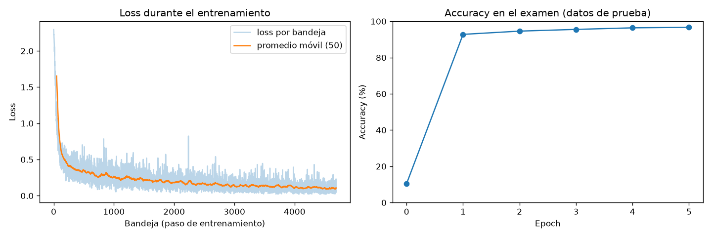
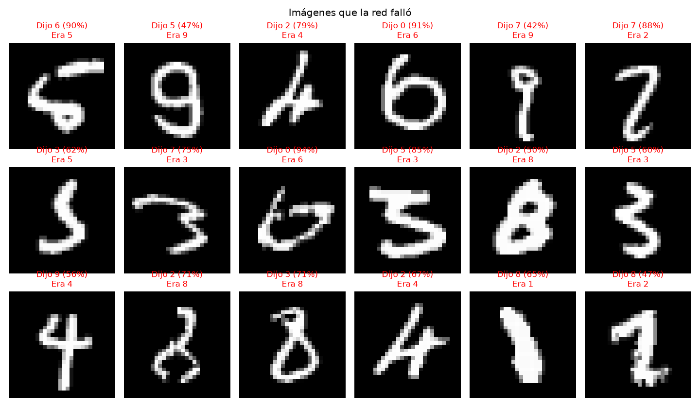

# Etapa 1: Red neuronal desde cero (MNIST)

Red neuronal escrita en **PyTorch** con un **training loop propio**, que reconoce dígitos escritos a mano (0–9) del dataset **MNIST**. Entrenada en una MacBook Air M1.

## 🧠 Arquitectura

```
Imagen [1, 28, 28] → Flatten (784) → Linear (784→128) → ReLU → Linear (128→10) → 10 logits
```

- **Parámetros:** 101,770 (pesos + sesgos)
- **Loss:** Cross-entropy
- **Optimizer:** SGD, learning rate 0.1
- **Batch size:** 64 · **Epochs:** 5

## 📊 Resultados

| Epoch | Loss (entrenamiento) | Accuracy (prueba) |
|---|---|---|
| 0 (sin entrenar) | — | 10.4% |
| 1 | 0.439 | 92.8% |
| 2 | 0.225 | 94.6% |
| 3 | 0.170 | 95.5% |
| 4 | 0.136 | 96.4% |
| 5 | 0.112 | **96.7%** |

La accuracy se mide con las **10,000 imágenes de prueba**, que la red nunca vio durante el entrenamiento.



## 🔍 Análisis de errores



- Muchos errores son dígitos **ambiguos** incluso para un humano.
- Cuando la red falla, suele hacerlo con **confianza baja** (40–60%).
- Hay errores con **confianza alta** (>90%), por ejemplo un 6 con la panza grande clasificado como 0. Al aplanar la imagen (`Flatten`), la red pierde la noción de forma. Las redes convolucionales (CNN) resuelven esto.

## ⚖️ Benchmark: CPU vs GPU (Apple M1)

| Device | Tiempo por epoch |
|---|---|
| **CPU** | **3.0 s** 🏆 |
| GPU (MPS) | 5.3 s |

Con un modelo tan pequeño y batches de 64, **la CPU es 1.8x más rápida**: el costo fijo de enviar cada batch a la GPU supera el beneficio del cálculo en paralelo. Lección: **medir, no suponer**.

## ▶️ Cómo ejecutarlo

Desde la raíz del repositorio:

```bash
python -m venv .venv
source .venv/bin/activate
pip install -r requirements.txt

python 01-red-neuronal/entrenar.py      # entrena y guarda las gráficas
python 01-red-neuronal/errores.py       # muestra las imágenes que la red falló
python 01-red-neuronal/cpu_vs_gpu.py    # benchmark CPU vs GPU
```

## 📁 Archivos

| Archivo | Qué hace |
|---|---|
| `ver_datos.py` | Explora el dataset MNIST |
| `modelo.py` | Define la red (`RedMNIST`) |
| `loss.py` | Calcula la loss de una red sin entrenar |
| `entrenar_un_lote.py` | Prueba de humo: entrenar con un solo batch |
| `entrenar.py` | Entrenamiento completo, evaluación y gráficas |
| `errores.py` | Análisis de errores |
| `cpu_vs_gpu.py` | Benchmark CPU vs GPU |

## 💡 Qué aprendí

- Tensores, `shape` y batches
- Forward pass, logits y softmax
- Cross-entropy loss
- Training loop: forward → loss → backpropagation → optimizer step
- Descenso de gradiente y learning rate
- Overfitting vs. generalización (datos de entrenamiento vs. prueba)
- Análisis de errores y benchmarking